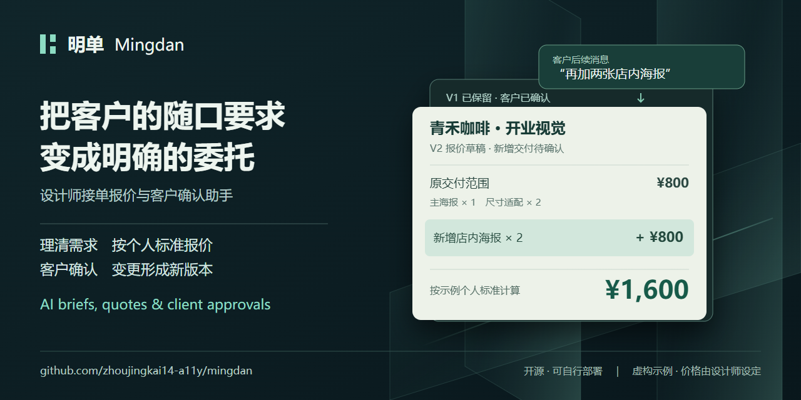
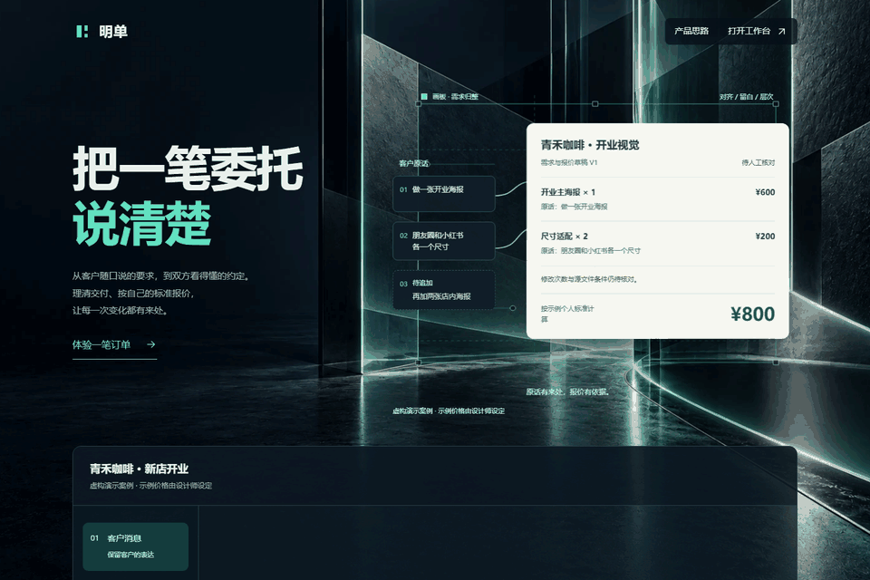

# Mingdan 明单

**AI briefs, quotes & client approvals for freelance designers.**

When a client asks for "two more posters", clarify the extra work, agree on the price, and keep the previous agreement intact.

Mingdan turns scattered client messages into a brief with source references. Designers review the scope, calculate quotes using their own rates, and send a version-specific confirmation link to the client.

[中文](README.md) · [Download beta](https://github.com/zhoujingkai14-a11y/mingdan/releases/tag/v0.1.0-beta.1) · [Order walkthrough, in Chinese](docs/GETTING-STARTED.md) · [Report an issue](https://github.com/zhoujingkai14-a11y/mingdan/issues/new/choose)

**Status: 0.1.0-beta.1, a self-hosted beta.** There is no public hosted trial provided by this project. The current interface, prompts and supported examples primarily target Chinese-language design briefs; this English introduction does not imply a fully localized English interface or validated English extraction quality.

## What it does

- Extract candidate requirements through a configured DeepSeek or compatible model API; keep the source text available for review.
- Leave missing details, conflicting information and unclear quantities unresolved for the designer to check.
- Reuse personal pricing rules, flag possible omissions, and calculate totals in code. The model does not set the final price.
- Preserve saved quote versions. Added work, replacements and rework can be reviewed in a new version.
- Let clients confirm a specific scope and price, or request changes, through a dedicated link. Clients do not need an account and cannot see internal conversations or the designer's rate table.
- Keep designer accounts isolated within the application and store data in SQLite.

## See the workflow

This demo uses fictional data, manually prepared requirements and example designer rates. The workflow was executed in a separate local environment: reviewed V1 at ¥800 → anonymous client confirmation → added work saved as V2 at ¥1,600. V1 stays confirmed. No live AI request was made for the demo; it does not demonstrate model accuracy or market pricing.

## Run locally

Install **Node.js 24.x**, including npm. The application has no third-party npm runtime dependencies.

~~~sh
git clone https://github.com/zhoujingkai14-a11y/mingdan.git
cd mingdan
npm run configure
npm start
~~~

Open <http://127.0.0.1:8765/>. Keep the server terminal running. Use the workbench link to create your own designer account and save the recovery key privately.

The configuration wizard stores secrets in your local .env file and refuses to overwrite an existing configuration. You provide your own model API key and pay your own provider's usage costs; no project-owner key is supplied. Leave the key empty to try the manual workflow. For an explicitly manual setup:

~~~sh
node tools/configure.mjs --manual
npm start
~~~

The instance administrator password is different from designer-account passwords. Each self-hosted instance has its own accounts and data. A localhost link will not work on a client's separate device: external use requires your own reachable deployment, persistent storage and HTTPS. GitHub Pages alone cannot run the Node backend.

## Validation and backups

~~~sh
npm ci --ignore-scripts --offline
npm run check:git
npm test
npm run backup
~~~

Tests use fictional data and simulated model responses, without paid model calls. Backups contain account and order data and must stay private. See [deployment and recovery](docs/DEPLOYMENT.md) and [verification scope](docs/PUBLICATION-CHECK.md), currently in Chinese.

## Current limits

- AI output requires human review; correctness for arbitrary input is not guaranteed.
- Email addresses are login identifiers without verification emails. Lost passwords depend on the recovery key saved at registration.
- Client names are not identity-verified. Confirmation is not payment or an electronic signature. There is no payment, escrow or subscription feature.
- Monthly AI spending is unlimited by default; request-rate and concurrency limits remain. Instance owners can set MINGDAN_AI_MONTHLY_BUDGET_CNY.
- Docker builds, production restore drills, real deployment networks and broader live-model quality still require validation.

## Feedback and license

Please use fictional or redacted examples in Issues. Keep API keys, recovery keys, private client messages and full customer links out of public reports. Report security issues through [private vulnerability reporting](https://github.com/zhoujingkai14-a11y/mingdan/security/advisories/new).

Licensed under [AGPL-3.0-only](LICENSE). See [contribution guidelines](CONTRIBUTING.md), [security notes](SECURITY.md) and [third-party notices](THIRD_PARTY_NOTICES.md). Promotional copy and artwork are collected in [the sharing kit](docs/promotion/README.md).
