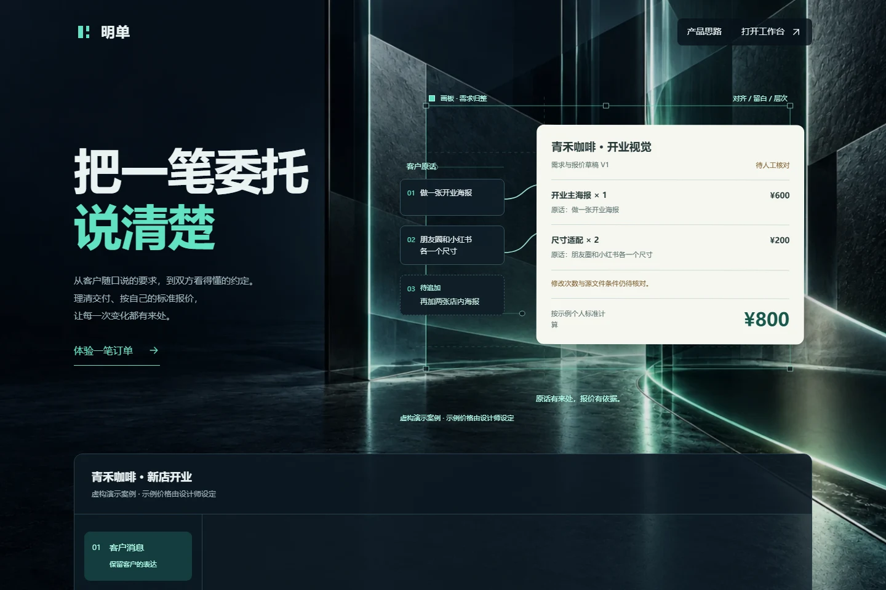

# 明单 · AI 需求整理与报价确认助手

把客户零散消息整理成带原话依据的需求清单，按设计师自己的标准计算报价，并保留每次变更与客户确认。

[新手教程](docs/GETTING-STARTED.md) · [下载测试版](https://github.com/zhoujingkai14-a11y/mingdan/releases/tag/v0.1.0-beta.1) · [反馈使用问题](https://github.com/zhoujingkai14-a11y/mingdan/issues/new/choose) · [版本记录](CHANGELOG.md)

**版本：0.1.0-beta.1，免费测试中的自部署软件，尚无本项目提供的公开托管试用地址。** 本仓库发布的是可运行的应用源码，GitHub 仓库本身不是在线服务。

## 可以完成什么

- DeepSeek 整理需求候选，回看原话；缺失、冲突和不明确数量保留待确认。
- 个人收费标准、人工核对、漏算提示与历史报价参考；AI 不决定最终价格。
- 保存不可改写的报价版本，后续增项、替换与重做形成新版本。
- 独立客户确认链接，接收确认或异议；客户不必注册，也看不到内部聊天和价目表。
- 多设计师账号隔离、恢复密钥、管理者使用统计与主动反馈。
- SQLite 持久化、在线一致性备份及请求频率和并发控制。

## 看一笔订单如何完成

下面的截图与演示来自当前应用的独立本机环境，使用虚构客户、人工整理及示例个人价格，真实模型调用数为 0。完整流程已实际执行：设计师审核 → 匿名客户确认 V1 → 新增交付保存 V2；原 V1 保持确认状态。示例价格不代表市场指导价。

| 客户消息 | 核对与报价 |
| --- | --- |
|  |  |

| 客户确认 | 变更与版本 |
| --- | --- |
|  |  |

演示采用自动预填的虚构字段和真实页面操作，用于展示软件流程；AI 理解质量需用自己的模型配置另行验证。逐屏操作和常见问题见[新手教程](docs/GETTING-STARTED.md)。

## 三步在本机运行

需要 **Node.js 24.x**（含 npm）。运行代码无需安装第三方 npm 依赖。

1. 下载[测试版源码](https://github.com/zhoujingkai14-a11y/mingdan/releases/tag/v0.1.0-beta.1)并解压，进入包含 `package.json` 的目录；或执行：

~~~sh
git clone https://github.com/zhoujingkai14-a11y/mingdan.git
cd mingdan
~~~
2. 创建本机配置：

~~~sh
npm run configure
~~~

模型 Key 通过终端隐藏输入填写；留空即可先用手动整理。脚本自动生成管理者密码，仅写入本机 `.env`，不会显示或上传。已有配置时脚本拒绝覆盖，修改请在本机编辑该文件。

3. 启动并打开首页：

~~~sh
npm start
~~~

浏览器打开 <http://127.0.0.1:8765/>，选择“打开工作台”，免费创建设计师账号。注册时必须保存恢复密钥。本机配置向导不复用项目作者的 Key；启用 AI 后费用由你配置的模型账号承担。

无需 AI 的首次检查可使用：

~~~sh
node tools/configure.mjs --manual
npm start
~~~

管理者入口使用 `.env` 中自动生成的密码；普通设计师使用自己的邮箱和密码。各个自部署实例的数据独立，不连接本项目此前的托管账号。

## 先体验完整流程

新建订单 → 粘贴已脱敏的客户消息 → AI 整理或手动填写 → 核对范围和条件 → 设置单价 → 保存报价版本并审核 → 创建客户链接 → 客户确认或提出异议 → 后续变更重新保存并确认。首页为标注虚构案例的交互展示，不会伪装成真实模型输出。

## 验证与备份

~~~sh
npm ci --ignore-scripts --offline
npm test
npm run backup
~~~

自动测试使用虚构数据和模拟模型响应，不调用真实 API、不收费，也不访问此前的订单库。备份包含本实例的账号和订单，属于私密资料，禁止上传 GitHub。恢复说明见 [部署与运维](docs/DEPLOYMENT.md)。

## 部署与项目结构

这是静态前端 + Node.js 服务端 + SQLite 的完整应用。保留 `sites-mingdan/` 路径是为了让已有模块与测试一致工作；运行本发布版无需 Next.js、Cloudflare、Sites 或它们的账号。

~~~text
deploy/                      Node HTTP 适配、备份与 HTTPS 部署模板
sites-mingdan/server/         账号、AI、报价验证、版本和用量逻辑
sites-mingdan/public/prototype/  前端工作台、首页和客户页面
sites-mingdan/drizzle/        空数据库结构迁移（无真实订单）
sites-mingdan/tests/          账号与交易确认流程测试
tools/                       本机配置与发布检查
~~~

公网运行还需要持久化磁盘、HTTPS、自己的域名/托管环境及 AI 服务配置。Docker 模板见 [部署与运维](docs/DEPLOYMENT.md)。GitHub Pages 仅适合静态展示，不能独立运行这套后端。

## 已知边界

- AI 可能遗漏或误解，必须由设计师复核；源码和测试不能保证任意文本都正确。
- 当前邮箱仅作登录标识，没有验证邮件；密码丢失后依赖事先保存的恢复密钥。
- 客户称呼没有身份核验，确认记录不代表付款；不包含支付、资金托管或电子签署。
- 默认没有月度 AI 费用上限；保留请求频率和并发限制。你可以自行设置 `MINGDAN_AI_MONTHLY_BUDGET_CNY`。
- 多用户隔离防止普通用户跨账号访问；实例所有者仍可管理数据库。
- 没有自动注销流程，删除请求需要实例管理者核对处理。

## 反馈、参与和开源

使用问题通过 GitHub Issues 提交，请使用虚构或脱敏案例；密钥、密码、恢复码、客户原话和完整备份不能提交。安全问题见 [SECURITY.md](SECURITY.md)，参与方式见 [CONTRIBUTING.md](CONTRIBUTING.md)。

采用 **AGPL-3.0-only**，完整条款见 [LICENSE](LICENSE)，来源与素材见 [THIRD_PARTY_NOTICES.md](THIRD_PARTY_NOTICES.md)。该许可证允许商用；修改后对外提供网络服务时，应按许可证向该服务用户提供相应源码。它不承诺独家销售权，也不会自动保护品牌名称。

本项目已从旧仓库迁入当前仓库，保留已公开的源码提交历史。验证记录与尚未验收的内容见[发布检查](docs/PUBLICATION-CHECK.md)，自行发布或贡献前见[上传说明](docs/GITHUB-PUBLISH.md)。
