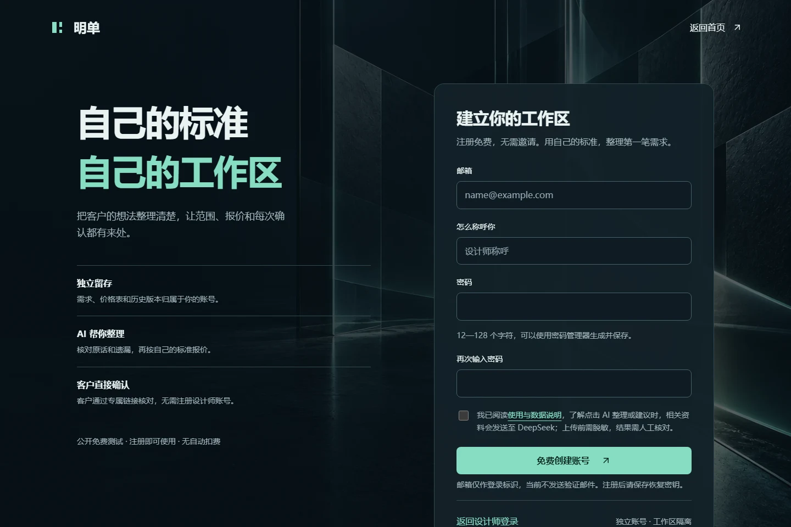
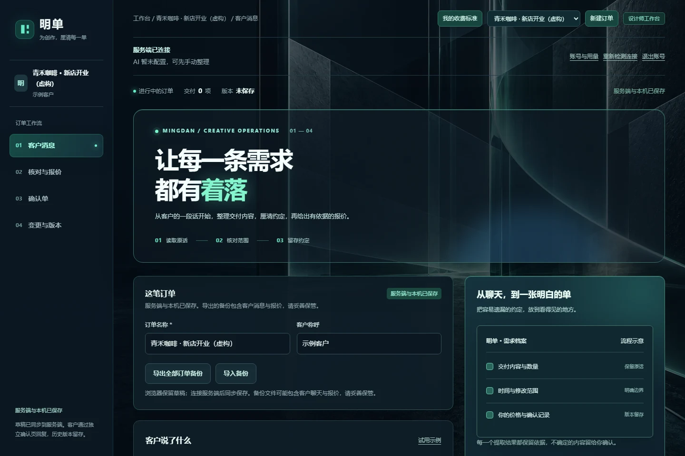
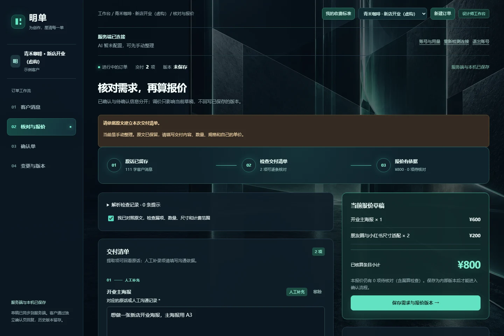
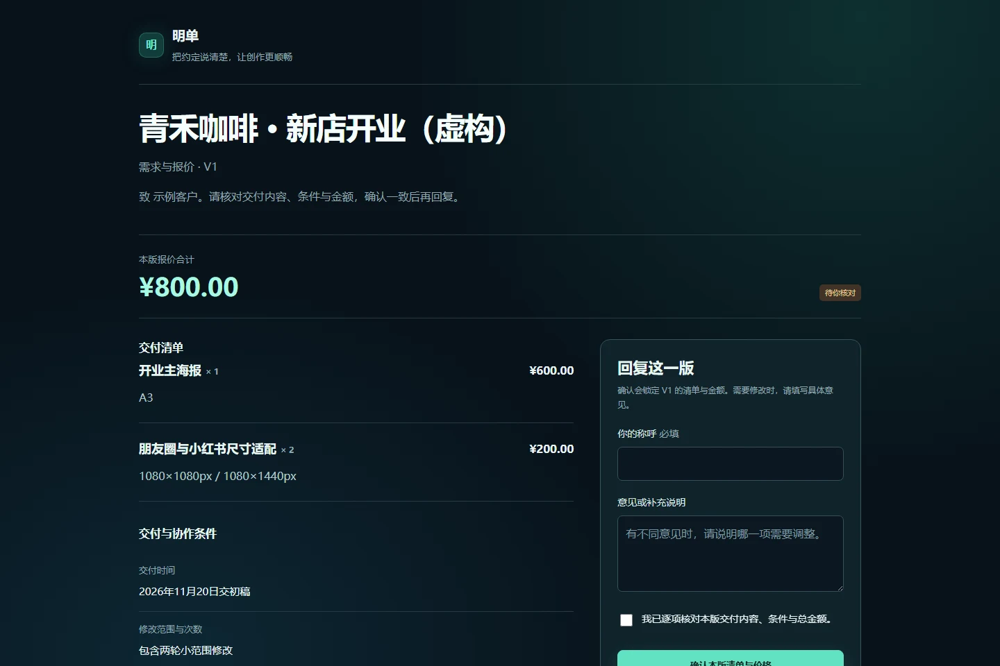
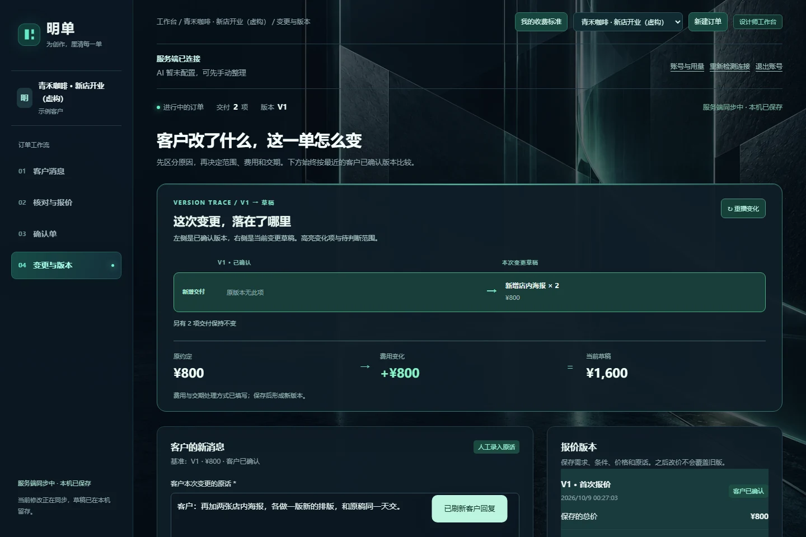

# 第一次使用明单

从安装到完成一笔订单。教程使用虚构的“青禾咖啡”订单；价格由示例设计师自行设置。可以先以手动方式走完整流程，再接入自己的 DeepSeek API。

## 1. 启动你的实例

安装 Node.js 24.x（包含 npm）。下载并解压[测试版源码](https://github.com/zhoujingkai14-a11y/mingdan/releases/tag/v0.1.0-beta.1)，在包含 `package.json` 的目录打开终端：

~~~sh
npm run configure
npm start
~~~

配置向导要求输入模型 API Key 时，可直接回车留空；密钥输入不会显示在终端。只想手动体验时，也可以使用：

~~~sh
node tools/configure.mjs --manual
npm start
~~~

浏览器打开 <http://127.0.0.1:8765/>。保留启动终端，关闭服务后网页会无法连接。

已经配置过则直接 `npm start`；配置向导拒绝覆盖已有 `.env`，以保护你之前的设置。

## 2. 创建自己的设计师账号

在首页点击“打开工作台”，进入注册入口。填写自己的邮箱标识、称呼、密码和确认密码，阅读 AI 数据处理说明。注册完成后妥善保存恢复密钥，再进入工作台。

邮箱目前不发送验证邮件。恢复密钥必须私下保存，不放进截图、GitHub Issue 或公开文档。管理者入口使用 `.env` 中生成的管理者密码，普通设计师使用自己的账号；两者用途不同。

## 3. 留存客户消息

点击“新建订单”，填写“青禾咖啡 · 新店开业（虚构）”及客户称呼。将下面的虚构消息粘贴到第一步：

> 客户：你好，想做一张新店开业海报，主海报用 A3，再适配朋友圈 1080×1080px 和小红书 1080×1440px 各一个尺寸。2026年11月20日交初稿，包含两轮小范围修改，本次不交付源文件，仅用于本店开业宣传。

手动体验请选择“手动整理”。已由实例管理者配置 DeepSeek 的情况下，可以使用 AI 整理，再逐项核对模型给出的候选和原话依据。点击 AI 整理会把消息发送给模型服务商，调用费用由实例使用的 API 账号承担。

## 4. 核对范围并填写自己的价格

在“核对与报价”中手动增加两项：

| 交付项 | 数量 | 示例单价 | 示例小计 |
| --- | --- | --- | --- |
| 开业主海报，A3 | 1 | ¥600 | ¥600 |
| 朋友圈与小红书尺寸适配 | 2 | ¥100 | ¥200 |

每一项填写对应原话；规格分别为 A3、1080×1080px 和 1080×1440px。补齐交付时间、两轮小范围修改、源文件不交付与尺寸条件。示例合计为 ¥800，实际项目请使用自己的收费标准。

展开“报价依据与漏算检查”中的常见遗漏检查。例子中的“源文件与使用权限如何交付？”会被关键词触发：依据客户原话核对，选择适当处理方式，并填写“不交付源文件，仅用于本店开业宣传”的依据。这个例子选择“本项目不需要”，没有新增费用。其他项目应按实际情况选择包含、单独计价或继续追问。

完成核对后勾选人工审核，再保存需求与报价版本。有待确认事项时可以保存内部草稿；解决提示后才能审核并生成客户链接。数量、价格和提示都会影响审核，不能只看合计金额。

## 5. 让客户确认这个版本

进入第三步“确认单”，检查 V1 的范围、协作条件和金额，记录设计师审核，然后生成客户确认链接。把完整链接私下发给客户，保留 `#` 后的部分。

客户可以在独立页面查看范围和金额，填写称呼、勾选已核对，再确认或提出具体调整意见，无需设计师账号。

设计师在工作台刷新客户回复，可以看到这个版本的确认状态。确认记录绑定本版内容；客户称呼未经身份核验，记录不代表付款，也没有电子签署能力。

本机练习时，在同一电脑打开链接即可。给外部客户使用前，实例必须部署到客户可访问的 HTTPS 地址；不能把自己的 `127.0.0.1` 链接当成公网地址。

## 6. 处理追加需求

客户又说：

> 客户：再加两张店内海报，各做一版新的排版，和原稿同一天交。

进入“变更与版本”，选择新增，判断为原约定之外的工作；填写“新增店内海报”、数量 2、示例单价 ¥400，并依据消息记录交期保持不变。

新增费用为 ¥800，新合计为 ¥1,600。保存 V2 后重新核对、审核并请客户确认。原来已确认的 V1 和 ¥800 报价保留，不能把旧确认当成客户对新增工作的同意。

约定内修改、设计师失误或系统理解错误，应按真实原因分类；程序不会把每一次修改自动变成额外收费。

## 7. 保存与备份

正常连接时草稿同步到这个实例的服务端；断开连接时查看工作台提示，保留本地草稿并恢复同步。已保存版本与工作草稿是不同记录。

~~~sh
npm run backup
~~~

备份包含这个实例的账号和订单，需要私密保管。恢复与公网部署见[部署与运维](DEPLOYMENT.md)。

## 常见问题

| 现象 | 处理方法 |
| --- | --- |
| `node` 或 `npm` 无法识别，或不认识启动参数 | 安装 Node.js 24.x，重新打开终端；在项目根目录运行命令 |
| `npm start` 提示端口被占用 | 找到自己的已启动实例，或在本机 `.env` 修改 `PORT` 后使用相应地址；不要随意停止别人的服务 |
| 浏览器显示拒绝连接 | 确认启动终端仍运行且没有报错，核对端口 |
| 提示配置已存在 | 不必重新配置，直接启动；改模型设置请在本机编辑 `.env` 后重启 |
| AI 尚未配置 | 实例管理者在服务端 `.env` 填写 `DEEPSEEK_API_KEY`；普通用户无法在网页中更换共享密钥 |
| AI 报错、额度不足或暂停 | 核对 Key、模型名称、供应商余额和实例限额；原文与草稿保留，可继续手动整理 |
| 报价没有办法审核 | 查找待确认条件、缺失原话、无效数量或金额、漏算提示；填写依据并重新勾选人工核对 |
| 忘记账号密码 | 使用注册时保存的恢复密钥恢复；没有邮件找回功能 |
| 客户打不开链接 | 保留完整 `#` 后访问码，确认链接未失效或撤回；外部客户不能访问你的 `127.0.0.1` |
| 以为 GitHub 下载版自带 AI 或原来的账号 | 每个自部署实例独立；使用自己的 Key 和本实例账号 |

仍有问题时，通过[使用问题模板](https://github.com/zhoujingkai14-a11y/mingdan/issues/new/choose)提交版本、系统、浏览器、预期结果及虚构复现案例。不要提交 Key、恢复密钥、真实客户原话、确认链接或备份。
